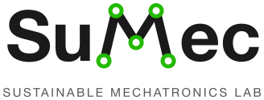

::: {.grid}
::: {.g-col-12 .g-col-md-7}
::: {.lead}

:::
:::

::: {.g-col-12 .g-col-md-5}
{fig-alt="SuMec Lab logo. The letter M is a chain of four rigid links with joints, a multibody system." style="width: 100%; max-width: 320px;"}
:::
:::

## Overview



---

## What we do



---

## What we deliver



---

## Applications



---

## Academic collaborators



Selected projects are listed on the Projects page.
→ *[Projects](/projects.qmd)*

---

## Lab presentation

A short introduction to the lab (September 2026).
→ *[Slides (HTML)](/talks/2026-09-lab-message/)* · *[PDF](/talks/2026-09-lab-message/slides.pdf)*

---

## Contact

We are open to visits, talks, invitations and collaboration with companies.
Email: grzegorz.orzechowski@lut.fi

---

## Events and links

Links to lab-related events are on the Events page.
→ *[Events](/events/index.qmd)*
